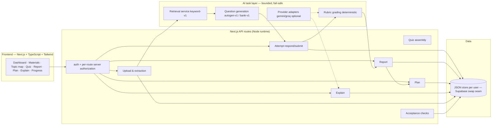

# Architecture

## Overview

## The two models stay separate (plan §7)

- **Content model:** documents → chunks → topic mapping → questions (with citations, keys, rubrics, versions).
- **Learner model:** attempts → responses → evaluations → topic evidence → gap report → plans.

Retrieval similarity never merges into learner modelling: topic status is computed ONLY from assessed responses via `src/lib/policy.ts`.

## Determinism boundaries

- Diagnosis: pure function of persisted evaluations (`policy.ts`) — no LLM.
- Planner: pure allocation + prerequisite ordering (`planner.ts`) — LLM may only phrase task wording.
- Grading: rubric concept matching, deterministic — an optional LLM may only *score short answers*, fail-safely degraded.
- Question generation: anchor-first offline generator; with a provider configured, drafting can be upgraded but the validation gate (citation resolves, key supported, distractors plausible) stays identical.

## Data model (MVP shapes, `src/lib/types.ts`)

`UserProfile`, `Workspace {documents, chunks, topics, questions, attempts, reports, plans, events}`.

Versioning: documents carry `version`; topic map carries `topicMapVersion`; reports & plans are **append-only history** (`superseded` flags) — old assessments are never silently rewritten (§14).

## Store seam (Supabase swap)

`src/lib/server/store.ts` exposes exactly two seams:

- `getStore()` — read the whole persisted state,
- `mutate(fn)` — serialized read-modify-write with persistence.

A Supabase/Postgres adapter maps the same JSON shapes onto tables; pgvector
replaces the keyword index (same `retrieveChunks` interface). **Honest caveat:**
the local file store does NOT survive serverless cold starts — run as a single
persistent instance (local demo) until the Supabase adapter is wired.

## Security decisions (§17)

- Passwords hashed (SHA-256 + server secret), HMAC-signed httpOnly session cookie.
- Every route resolves the user server-side; **no client-supplied ids are trusted**; cross-user access returns 404/401 (verified by `scripts/eval-demo.mjs`).
- Workspace-scoped retrieval: a user can never retrieve another user's chunks by construction.
- Returned quiz payloads strip answer keys, distractor rationales and citation quotes until submission (§25.4).
- Uploads: size/type caps, honest rejection of scanned/empty files, same-filename replace = new version.
- Students' answer text treated as untrusted data (length limits, never executed).
